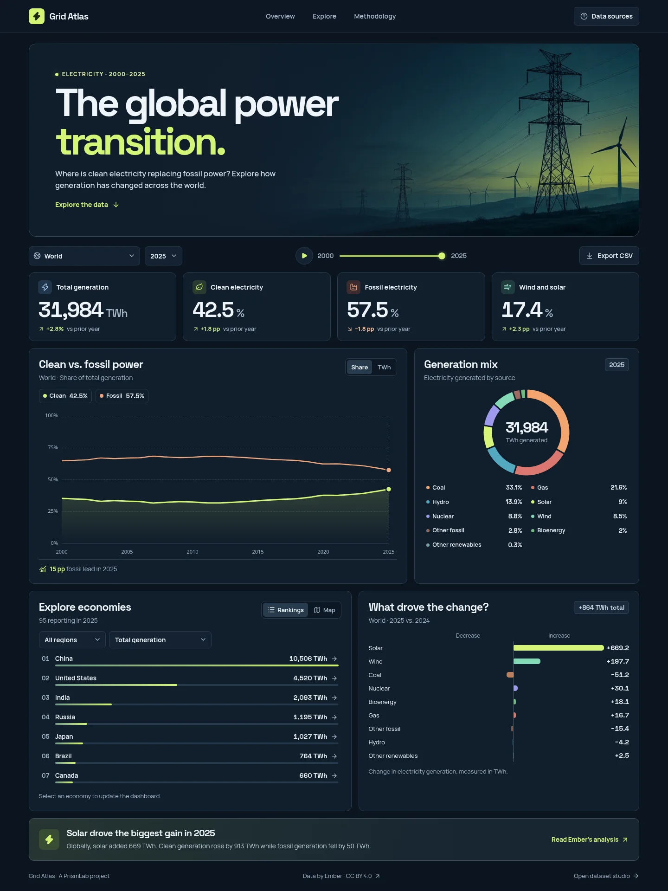

# Grid Atlas

**Where is clean electricity replacing fossil power?** Grid Atlas is PrismLab’s interactive electricity dashboard. It tracks how the generation mix changed between 2000 and 2025 across the world and 209 economies, using open data from Ember.



## Explore the data

- Set an economy and year, scrub or play the timeline, or select a year directly on the trend chart.
- Switch the trend between percentage share and TWh. Toggle clean or fossil generation, then select a source on the mix chart to see its share.
- Explore the map or rank economies by generation, clean share, or five-year change. Selecting an economy updates the metrics, timeline, mix and year-over-year chart.
- Open **Methodology** for definitions and coverage, or export the selected economy’s full time series as CSV.

[Research notes](docs/grid-research.md) · [Mobile preview](docs/screenshots/grid-atlas-mobile.webp) · [Ember Yearly Electricity Data](https://ember-energy.org/data/yearly-electricity-data/)

## Run locally

Requires Node.js 22+ and curl. The dashboard uses Next.js App Router, React, TypeScript and ECharts. It runs as a static export with locally served fonts and data.

```sh
npm ci
npm run dev
```

Open http://localhost:3000. [The original PrismLab dataset workspace](docs/studio.md) is available at `/studio/`.

```sh
npm run lint
npm run typecheck
npm test
NEXT_PUBLIC_BASE_PATH=/PrismLab-DV npm run build
npx playwright install chromium
NEXT_PUBLIC_BASE_PATH=/PrismLab-DV npm run e2e
```

The production export is served under `/PrismLab-DV/` on GitHub Pages. Set **Settings → Pages → Source** to **GitHub Actions** to use the repository’s deployment workflow.
