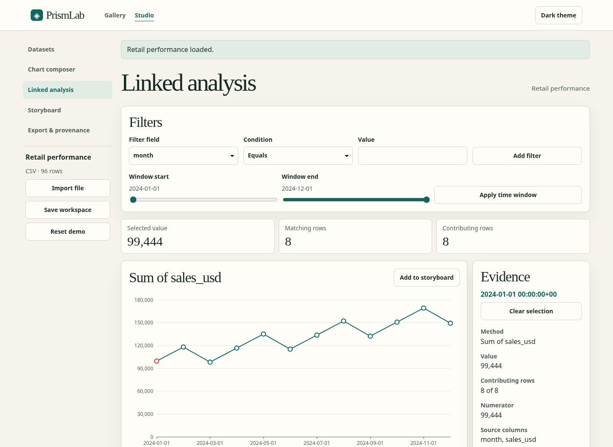

# PrismLab

PrismLab is a browser-based studio for exploring datasets and telling stories with evidence. Select a chart point to see the contributing records, or add the chart and its exact query to a storyboard.



## Run locally

Requires Node.js 22 or later and curl. Node.js 24 is used in CI.

```sh
npm ci
npm run dev
```

Open http://localhost:3000. A production build also works with a static file server.

```sh
npm run build
npm run preview
```

## Walkthrough

1. Load the retail demo or import CSV or Parquet. **Datasets** shows inferred types, missing and invalid values, and source previews. Use the USGS demo for geographic coordinates.
2. In **Chart composer**, choose a measure, aggregation, and one of six chart types. Set a time grain or add filters. Histogram uses a numeric X field. Map requires latitude and longitude columns.
3. In **Linked analysis**, select a chart point or a row in the Chart data table. The evidence inspector, contributing-rows chart, and underlying records update. Apply a time window or capture a baseline to compare a second filter state.
4. Add a chart to **Storyboard**. Write a claim, caveat, and alternative interpretation, then present the cards or revisit the evidence behind them.
5. In **Export & provenance**, save to IndexedDB or download a project JSON, chart PNG/SVG, aggregate CSV, or self-contained story HTML. Import the JSON to reproduce the workspace.

[Gallery](screenshots/gallery.png) · [Mobile composer](screenshots/mobile-composer.png) · [Case study](case-study.md) · [Architecture](architecture.md) · [Project status](../PROJECT_STATUS.md)

## Data and limits

The examples are a fictional retail CSV and a curated January 2024 USGS earthquake snapshot. [The data manifest](../fixtures/manifest.json) records sources, licenses, and checksums. To rebuild the Parquet snapshot from the included source CSV, install Python DuckDB 2.0.1 and run `python scripts/prepare-fixtures.py`. The basemap is Natural Earth.

Local files stay in the browser. The app limits files to 30 MiB, 80 columns, and 1,000,000 rows. Browser memory may limit dense or heavily compressed Parquet before those caps. Chart and evidence table limits are described in the [architecture notes](architecture.md). Blank strings are treated as missing, column distinct counts are approximate, and duplicate source labels use DuckDB's normalized labels. IndexedDB holds one saved workspace per browser profile. Offline access depends on a prior online visit and available browser storage.

## Verification and deployment

```sh
npm run lint
npm run typecheck
npm test
NEXT_PUBLIC_BASE_PATH=/PrismLab-DV npm run build
npx playwright install chromium
NEXT_PUBLIC_BASE_PATH=/PrismLab-DV npm run e2e
```

To deploy this repository, set **Settings → Pages → Source** to **GitHub Actions**. The Pages workflow builds the static export for `/PrismLab-DV` and deploys after successful verification on `main`. It can also be dispatched manually.
